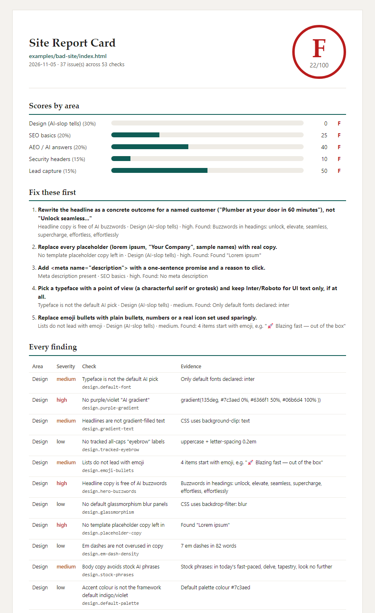
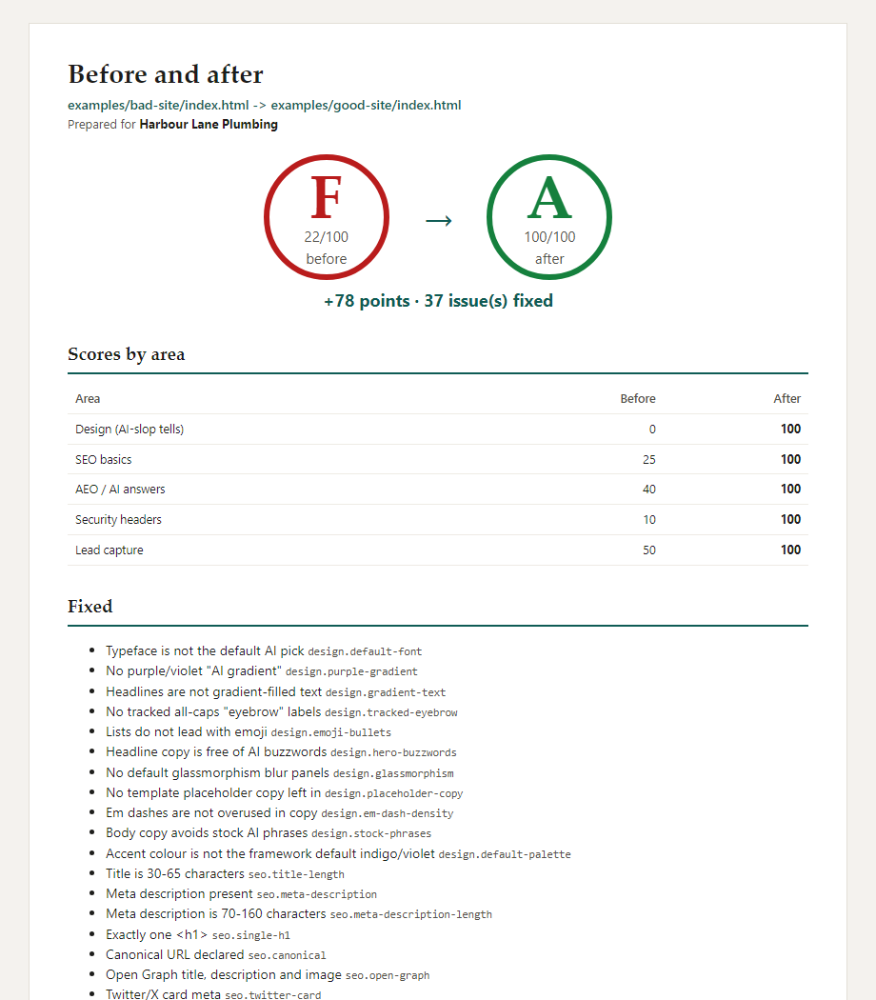

# site-slopcard

**Give it a URL. Get a one-page Site Report Card, graded A to F, that you can hand straight to a client.**

It checks for the design tells that make a site look AI-made, plus SEO and AEO basics, security headers and lead-form health. A Claude Code skill then fixes what it found in your own repo.

impeccable and hallmark tell _you_ that your UI looks AI-made. site-slopcard tells your _client_, in one page, and then fixes it.

<!-- HERO GIF: docs/hero.gif (CLI run -> report card opens). Recording pending; the screenshot below is a real run. -->



## 30-second quickstart

```bash
npx site-slopcard https://your-site.com
# -> slopcard-out/report.html  (printable, one page)
#    slopcard-out/report.md
#    slopcard-out/report.json
```

No install, no API key, no runtime dependencies. Needs Node 20 or newer.

Try it offline on the bundled demo pages:

```bash
npx site-slopcard --file examples/bad-site/index.html    # F 22
npx site-slopcard --file examples/good-site/index.html   # A 100
```

## What it checks

53 deterministic rules in five groups. Every finding carries `id`, `group`, `severity`, `evidence`, `fix` and `source` (the checklist it came from).

| Group                      | Weight | Examples                                                                                                                                                                                                                                         |
| -------------------------- | -----: | ------------------------------------------------------------------------------------------------------------------------------------------------------------------------------------------------------------------------------------------------ |
| **Design** (AI-slop tells) |     30 | Inter/Roboto-only type, purple-to-cyan gradients, gradient headline text, tracked all-caps eyebrows, emoji bullets, "Unlock seamless..." hero copy, lorem ipsum, glassmorphism, em-dash overuse. Plus impeccable's 62 rules when it is installed |
| **SEO**                    |     20 | title and meta lengths, one H1, canonical, Open Graph, Twitter card, valid JSON-LD, image alt coverage, `lang`, viewport, noindex, sitemap                                                                                                       |
| **AEO** (AI answers)       |     20 | `/llms.txt`, robots rules for GPTBot / ClaudeBot / PerplexityBot / Google-Extended, FAQPage/HowTo schema, entity schema, answer-first paragraph, question headings, freshness                                                                    |
| **Security**               |     15 | HTTPS, HSTS, CSP, nosniff, Referrer-Policy, clickjacking, version leaks, mixed content, secret-shaped keys in page JS (redacted), third-party script count, SRI on CDN scripts                                                                   |
| **Leads**                  |     15 | a contact path exists, form present, form action is real, HTTPS action, endpoint answers a HEAD probe, labelled fields, `type="email"`, a clear CTA, a tel:/WhatsApp link                                                                        |

Grade: A 90+, B 80+, C 70+, D 60+, F below 60. Checks that cannot run (for example headers in offline mode) are marked n/a and left out of the score instead of counting against you.

## Before and after

```bash
npx site-slopcard compare before/report.json after/report.json
# F 22 -> A 100 (+78)
```



The sample outputs in [`examples/sample-out/`](examples/sample-out/) were generated by `npm run sample`. Live runs against our own sites are in [`examples/sample-out/live/`](examples/sample-out/live/) (skynetjoe.com scored B 89 on 2026-11-05, so we have work to do too).

## Use it in Claude Code

```bash
mkdir -p ~/.claude/skills && cp -r skill/site-slopcard ~/.claude/skills/
```

Then, inside the repo for your site:

```
/site-slopcard https://your-site.com
```

The skill runs the CLI, reads `report.json`, proposes up to five fixes, edits only the local repo you own, re-runs the scan and hands you the before/after card. See [`skill/site-slopcard/SKILL.md`](skill/site-slopcard/SKILL.md).

## For agencies

```bash
npx site-slopcard https://prospect-site.com --client "Harbour Lane Plumbing" --brand-color "#0f5c55"
```

- `--client` prints "Prepared for ..." on the card. `--brand-color` sets the accent.
- Open `report.html` and print to PDF. It is laid out for one page, with a light theme.
- The only branding is one small "Generated with site-slopcard" footer link.
- Get permission before you audit a prospect's site, then send the card with your offer.

## CI

```bash
npx site-slopcard https://staging.your-site.com --fail-under 80
```

The exit code is 0 unless `--fail-under N` is set and the score is below N (exit 1). Usage or network errors exit 2. A sample GitHub Actions workflow is in [`_pending-ci/test.yml`](_pending-ci/test.yml).

## All options

```
site-slopcard <url> [--out dir] [--json] [--no-impeccable] [--hallmark <dir>]
                    [--client "Name"] [--brand-color #hex] [--fail-under N]
site-slopcard --file <index.html> [same options]
site-slopcard compare <before.json> <after.json> [--out dir]
```

- **impeccable** runs automatically when it is installed (`npm i -g impeccable`). We call `npx --no-install`, so nothing is downloaded behind your back. Without it the report notes "design: partial" and still scores. Use `--no-impeccable` to skip it.
- **hallmark**: pass `--hallmark path/to/hallmark-checkout` to also run its sloplint on a snapshot of the page.
- **Offline mode** (`--file`) also reads `robots.txt`, `llms.txt`, `sitemap.xml`, `headers.json` and local stylesheets sitting next to the HTML file.

## Standing on the shoulders of...

| Project                                                                               | Licence    | What we took                                                                                       |
| ------------------------------------------------------------------------------------- | ---------- | -------------------------------------------------------------------------------------------------- |
| [pbakaus/impeccable](https://github.com/pbakaus/impeccable)                           | Apache-2.0 | Its 62-rule detector, **called** as an external CLI when installed. Never copied.                  |
| [Nutlope/hallmark](https://github.com/Nutlope/hallmark)                               | MIT        | sloplint, **called** from your own checkout. Its FAIL / REFLEX / WARN tiers shaped our severities. |
| [Leonxlnx/taste-skill](https://github.com/Leonxlnx/taste-skill)                       | MIT        | Design-intent vocabulary for the skill's fix advice, paraphrased.                                  |
| [AgriciDaniel/claude-seo](https://github.com/AgriciDaniel/claude-seo)                 | MIT        | SEO and AEO checklist ideas, **reimplemented** as our own checks.                                  |
| [cloudflare/security-audit-skill](https://github.com/cloudflare/security-audit-skill) | MIT        | Client-side security checklist ideas, **reimplemented** as passive checks.                         |
| [waseemnasir2k26/lead-leak-audit](https://github.com/waseemnasir2k26/lead-leak-audit) | MIT        | Form discovery, reimplemented as detection only.                                                   |

Full details, copyright lines and the upstream credit chain are in [THIRD_PARTY_NOTICES.md](THIRD_PARTY_NOTICES.md). site-slopcard works with these tools but is not affiliated with them.

## Related / prior art

Smaller projects in the same space, credited honestly:
[DefiTanjiro/ai-slop-detector](https://github.com/DefiTanjiro/ai-slop-detector) ·
[maxbov1/antislop](https://github.com/maxbov1/antislop) ·
[SkilakLabs/slop-audit](https://github.com/SkilakLabs/slop-audit) ·
[VoidLight00/aislop](https://github.com/VoidLight00/aislop) ·
[Gouravmaurya/colabio-frontend](https://github.com/Gouravmaurya/colabio-frontend).
site-slopcard's angle is combining design, SEO/AEO, security and lead health into one graded, client-ready page.

## Privacy and safety

**Only scan sites you own or have permission to audit.**

- Passive and read-only: GET and HEAD only. Forms are never submitted; form endpoints get at most one HEAD request, and only on the same origin.
- One page per run, plus `robots.txt`, `llms.txt`, the sitemap and up to three same-origin stylesheets. No crawling.
- robots.txt is respected. If it disallows the page for `site-slopcard`, we stop.
- At most 1 request per second, a 10 second timeout, and an honest User-Agent: `site-slopcard/1.0 (+https://github.com/waseemnasir2k26/site-slopcard)`.
- Off-site redirects are refused. Only same-site hops (www and http to https) are followed.
- Anything shaped like a secret key is reduced to 4 characters plus its length in every output.
- No telemetry. Reports stay on your machine.

## Development

```bash
npm test          # 179 offline tests, node:test, no network
npm run sample    # regenerate examples/sample-out/
```

## Licence

MIT. See [LICENSE](LICENSE).

## Built by SkynetLabs

Want the fixes done for you? Message Waseem on [WhatsApp](https://wa.me/6281316077185) or email [waseem@skynetjoe.com](mailto:waseem@skynetjoe.com).
